# TugasWeb-P11-EcommerceAuth

## Tugas Pemrograman Web Pertemuan 11

Project Laravel dengan implementasi **E-Commerce Database, Eloquent ORM, Authentication, Multi-Role Authorization, PostPolicy, Eager Loading, dan Filament Admin Panel**.

---

## Identitas

**Nama:** Moudy Emellin  
**Mata Kuliah:** Pemrograman Web  
**Tugas:** Pertemuan 11 — E-Commerce Database & Secure Authentication

---

## Teknologi yang Digunakan

- Laravel 12
- PHP 8.5
- MySQL
- Laravel Breeze
- Blade
- Tailwind CSS
- Eloquent ORM
- Laravel Tinker
- Filament 5.9
- Composer
- Vite

---

# A. Database & Eloquent

## Struktur Database

Project menggunakan 7 tabel utama E-Commerce:

1. `users`
2. `categories`
3. `products`
4. `orders`
5. `order_items`
6. `tags`
7. `product_tag`

Selain itu terdapat tabel:

- `posts`

Tabel `posts` digunakan untuk implementasi dan pengujian **PostPolicy**.

---

## Relasi Antar Model

Relasi yang digunakan:

- User `hasMany` Products
- User `hasMany` Orders
- Category `hasMany` Products
- Product `belongsTo` Category
- Product `belongsTo` User
- Product `belongsToMany` Tags
- Tag `belongsToMany` Products
- Order `belongsTo` User
- Order `hasMany` OrderItems
- OrderItem `belongsTo` Order
- OrderItem `belongsTo` Product
- Post `belongsTo` User

---

## Seeder dan Factory

Seeder dan Factory digunakan untuk membuat data dummy E-Commerce.

Data yang dibuat:

- 3 akun multi-role
- 10 kategori
- 10 tag
- 60 produk
- 6 order
- Order Item
- Relasi Product dengan Tag

Jumlah produk telah memenuhi ketentuan minimal **50+ produk**.

---

## Query Scope

Pada model `Product` terdapat scope:

```php
Product::active()
```

Scope digunakan untuk mengambil produk yang memiliki status aktif.

---

# B. Authentication & Security

## Laravel Breeze

Authentication dibuat menggunakan **Laravel Breeze**.

Fitur yang telah diuji:

- Register
- Login
- Logout
- Dashboard setelah login

### Bukti Dashboard

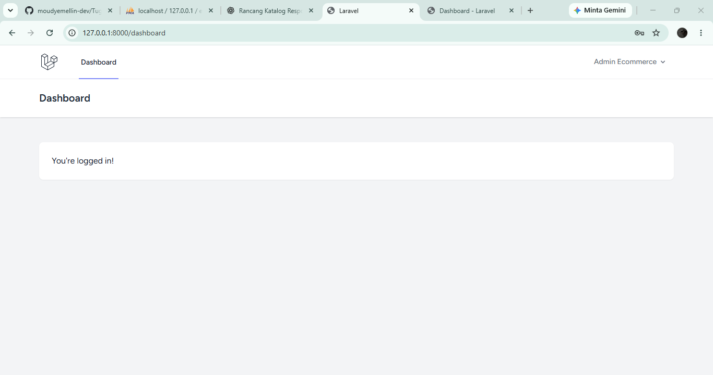

---

# C. Multi-Role

Project memiliki 3 role:

- Admin
- Editor
- User

Custom middleware digunakan untuk membatasi akses halaman berdasarkan role.

---

## Role Admin

Admin dapat mengakses:

```text
/role-admin
```

### Hasil Testing

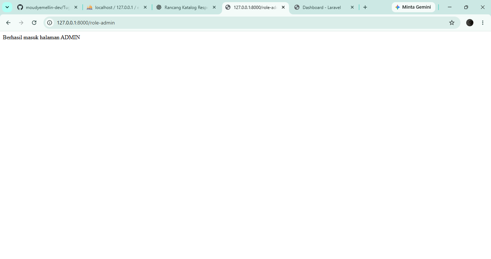

---

## Role Editor

Editor tidak dapat mengakses halaman khusus admin.

Ketika Editor membuka:

```text
/role-admin
```

maka sistem menghasilkan:

```text
403 Forbidden
```

### Hasil Testing

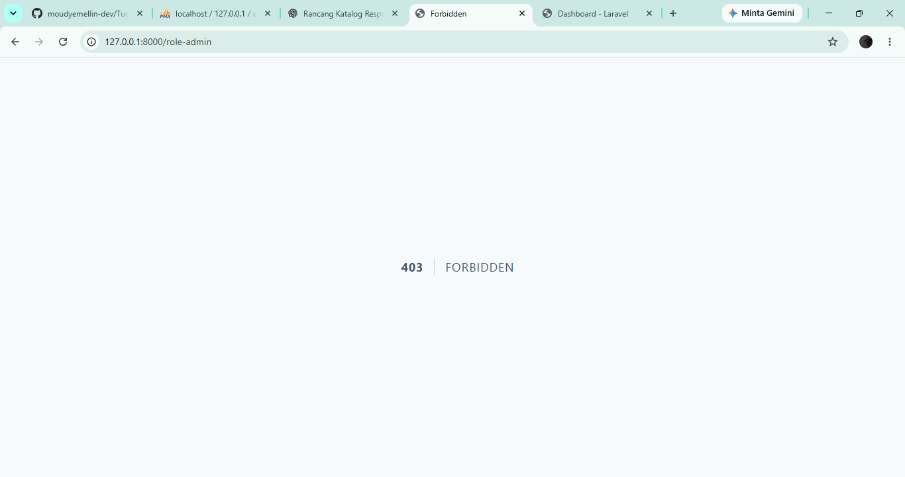

---

## Role User

User dapat mengakses:

```text
/user
```

### Hasil Testing

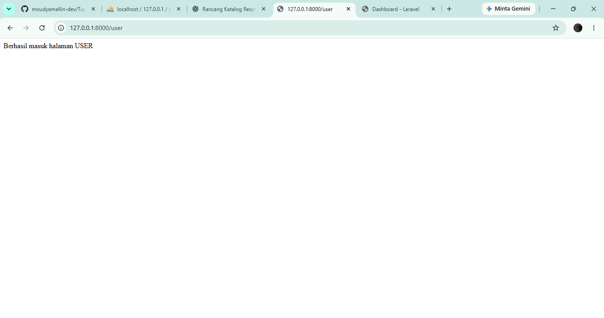

---

# D. PostPolicy

Project menggunakan `PostPolicy` untuk mengatur otorisasi edit dan delete post.

Aturan yang digunakan:

- **Admin** dapat update dan delete semua post.
- **Editor** dapat update dan delete semua post.
- **User** hanya dapat update dan delete post miliknya sendiri.

PostPolicy telah diuji menggunakan Laravel Gate melalui Tinker.

Contoh pengujian:

```php
Gate::forUser($user)->allows('update', $post);
```

User pemilik post menghasilkan:

```text
true
```

Sedangkan user yang mencoba mengedit post milik akun lain menghasilkan:

```text
false
```

---

# E. Dokumentasi Laravel Tinker

## Query 1 — Menghitung Produk

```php
\App\Models\Product::count();
```

Hasil:

```text
60
```

### Screenshot

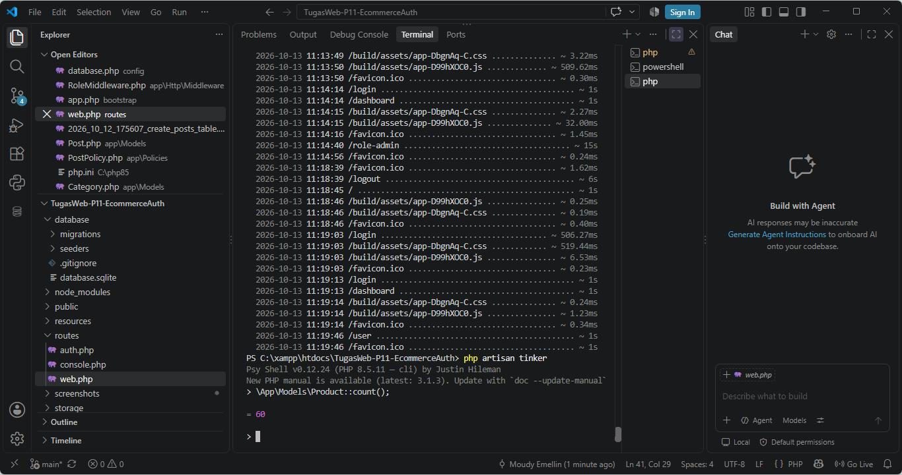

---

## Query 2 — Product dengan Category

```php
\App\Models\Product::with('category')->first();
```

### Screenshot

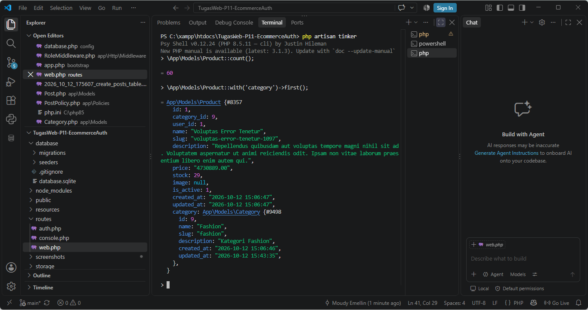

---

## Query 3 — Menghitung Order User

```php
\App\Models\User::first()->orders->count();
```

### Screenshot

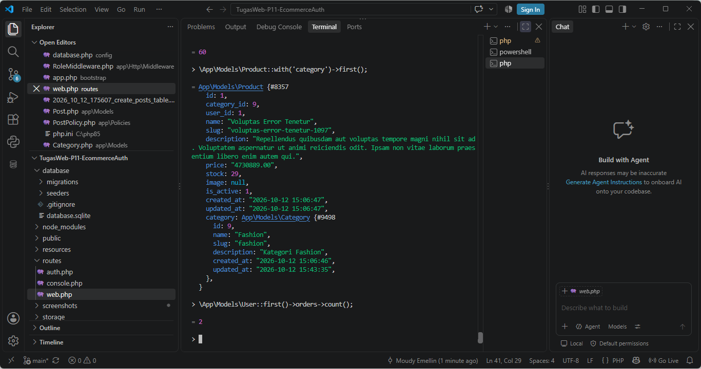

---

## Query 4 — Order dengan Total Item

```php
\App\Models\Order::withSum('items as total', 'price')->first();
```

### Screenshot

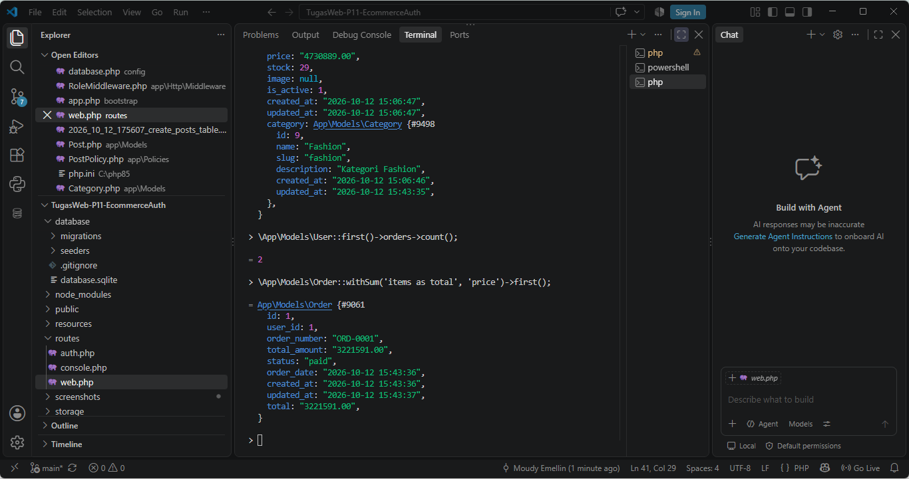

---

## Query 5 — Produk Kategori Elektronik

```php
\App\Models\Product::whereRelation(
    'category',
    'name',
    'Elektronik'
)->get();
```

### Screenshot

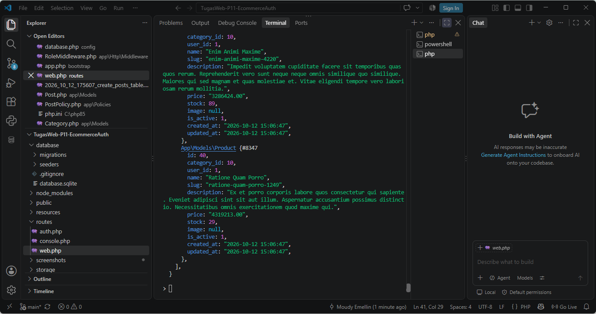

---

# F. Bonus — Eager Loading

Eager Loading digunakan untuk mengambil data Product beserta Category secara bersamaan.

Query:

```php
\App\Models\Product::with('category')->take(5)->get();
```

### Screenshot

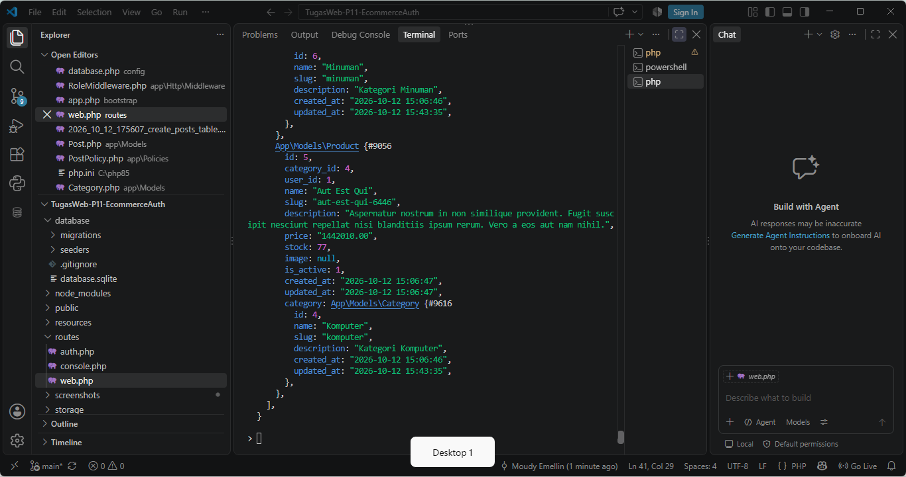

---

# G. Bonus — Filament Admin Panel

Project telah menggunakan **Filament 5.9** sebagai Admin Panel.

Panel dapat diakses melalui:

```text
http://127.0.0.1:8000/admin
```

### Screenshot

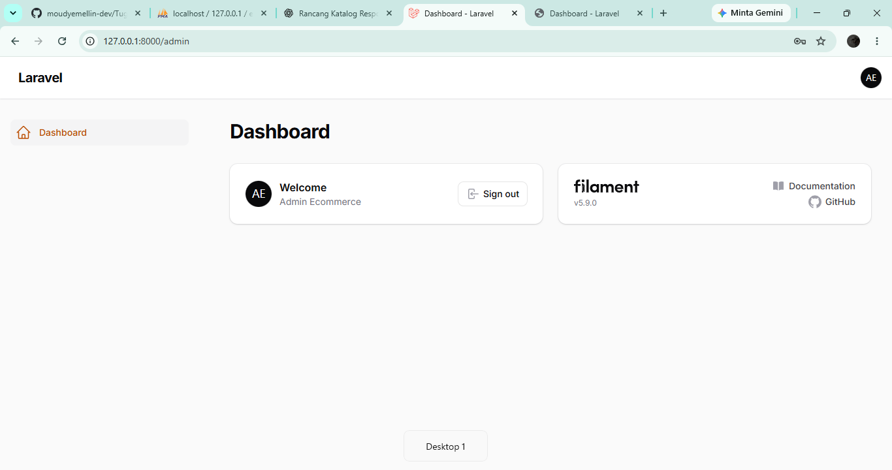

---

# Akun Testing

## Admin

```text
Email    : admin@example.com
Password : password
Role     : admin
```

## Editor

```text
Email    : editor@example.com
Password : password
Role     : editor
```

## User

```text
Email    : user@example.com
Password : password
Role     : user
```

Akun tersebut hanya digunakan untuk keperluan testing project.

---

# Cara Menjalankan Project

## 1. Clone Repository

```bash
git clone https://github.com/moudyemellin-dev/TugasWeb-P11-EcommerceAuth.git
```

Masuk ke folder:

```bash
cd TugasWeb-P11-EcommerceAuth
```

---

## 2. Install Dependency Laravel

```bash
composer install
```

---

## 3. Buat File Environment

Windows:

```bash
copy .env.example .env
```

Kemudian generate key:

```bash
php artisan key:generate
```

---

## 4. Buat Database

Buat database MySQL dengan nama:

```text
ecommerce_p11_db
```

Atur `.env`:

```env
DB_CONNECTION=mysql
DB_HOST=127.0.0.1
DB_PORT=3306
DB_DATABASE=ecommerce_p11_db
DB_USERNAME=root
DB_PASSWORD=
```

---

## 5. Jalankan Migration

```bash
php artisan migrate
```

---

## 6. Jalankan Seeder

```bash
php artisan db:seed --class=EcommerceSeeder
```

---

## 7. Install Frontend Dependency

```bash
npm install
```

Build asset:

```bash
npm run build
```

---

## 8. Jalankan Laravel

```bash
php artisan serve
```

Buka:

```text
http://127.0.0.1:8000
```

---

# Repository

**Repository GitHub:**

```text
https://github.com/moudyemellin-dev/TugasWeb-P11-EcommerceAuth
```

**Nama Repository:**

```text
TugasWeb-P11-EcommerceAuth
```

---

## Kesimpulan

Pada Tugas Pertemuan 11 ini telah diterapkan:

- Migration database E-Commerce
- Foreign Key
- Seeder dan Factory
- 60 data produk
- Eloquent Relationship
- Query Scope
- Laravel Tinker
- Laravel Breeze
- Login, Register, dan Logout
- Multi-Role Admin, Editor, dan User
- Custom Role Middleware
- Route Protection
- PostPolicy
- Authorization menggunakan Gate
- Eager Loading
- Filament Admin Panel